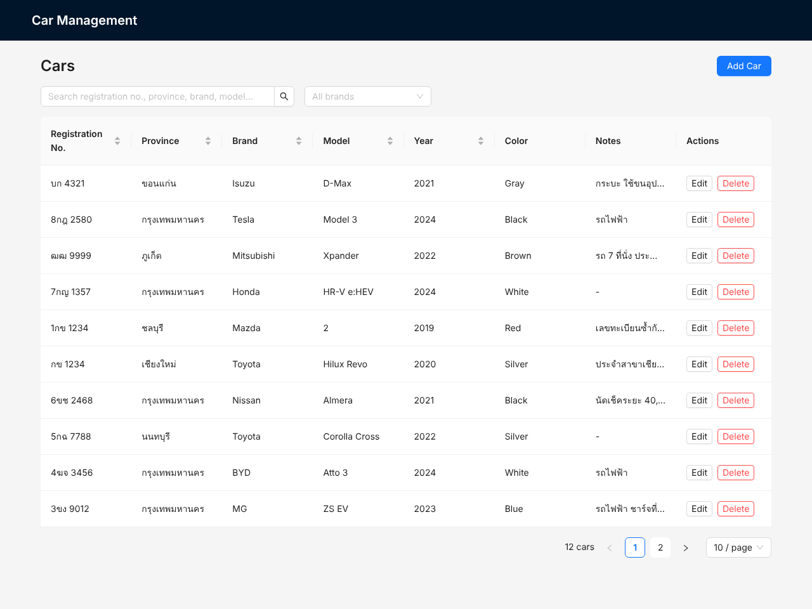
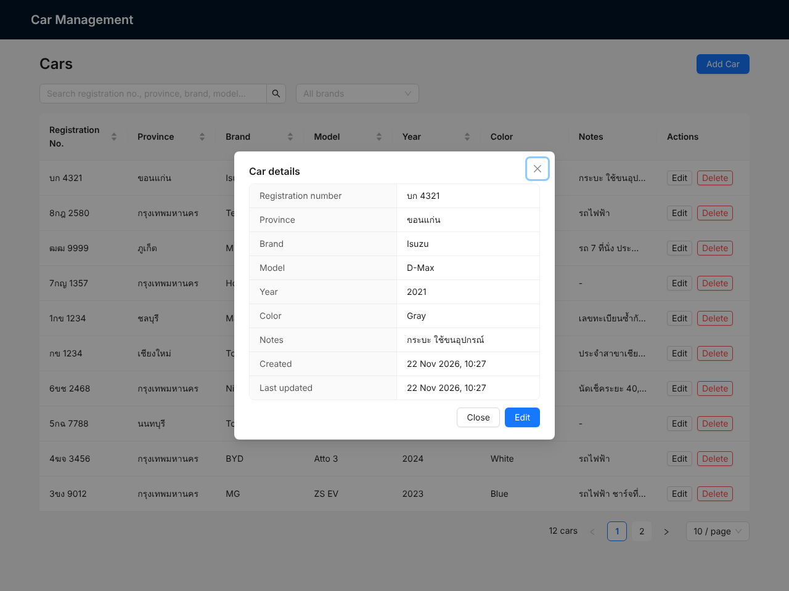
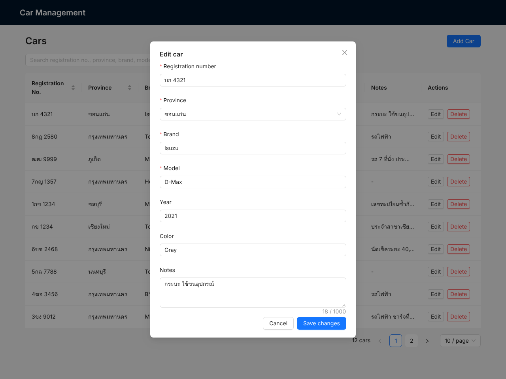

# Car Management System

A web application that replaces a paper notebook for recording a company's cars. Staff can add,
view, search, edit and delete car records from a browser, and the data is stored in a PostgreSQL
database behind a RESTful API.



## Contents

- [Requirements Checklist](#requirements-checklist)
- [Additional Features](#additional-features)
- [Tech Stack](#tech-stack)
- [Quick Start with Docker](#quick-start-with-docker)
- [Local Development](#local-development)
- [Project Structure](#project-structure)
- [Web Interface](#web-interface)
- [Data Model and Validation](#data-model-and-validation)
- [API Reference](#api-reference)
- [Git Workflow](#git-workflow)

## Requirements Checklist

| Requirement                      | Where it is implemented                                                      |
| -------------------------------- | ---------------------------------------------------------------------------- |
| 1. Add new car information       | **Add Car** dialog → `POST /api/cars`                                        |
| 2. View all car information      | Car list with paging, search and filters → `GET /api/cars`, details dialog   |
| 3. Edit car information          | **Edit** dialog → `PATCH /api/cars/:id`                                      |
| 4. Delete car information        | **Delete** with confirmation → `DELETE /api/cars/:id`                        |
| Web frontend with React.js       | `frontend/` — React 19, TypeScript, Vite                                     |
| RESTful API with Node.js         | `backend/` — Express 5, TypeScript                                           |
| CRUD API and database            | PostgreSQL 17 via Prisma ORM, migrations in `backend/prisma/migrations`      |
| Web design with a UI framework   | Ant Design v6 (see [Web Interface](#web-interface))                          |
| Git version control, public repo | History from the first commit on GitHub, feature branches merged through PRs |

## Additional Features

Beyond the basic requirements:

- **Search, filter, sort and paginate** the car list on the server. The current search, filter,
  sort and page are kept in the URL, so refresh and the browser's back button keep them.
- **Car details dialog**: click any row to see every field, including created and updated times.
- **Thai registration plate validation**: plates must look like `1กข 1234` or `กข 1234`, and
  spacing is normalized (`1กข1234` is stored as `1กข 1234`).
- **Duplicate protection**: the same plate cannot be registered twice in the same province
  (Thai plates are only unique within a province). The API answers `409 Conflict` and the form
  shows the message under the registration number field.
- **Easy data entry**: a searchable list of all 77 provinces and brand suggestions from existing
  data.
- **Validation on both sides**: the form checks input before sending, and the API validates every
  request with Zod and returns field-level errors that the form displays under each input.
- **Consistent error format** for every API error (see [Errors](#errors)).
- **Health check** endpoint that also reports whether the database is reachable.
- **Sample data**: 12 cars are seeded into an empty database.
- **One-command setup**: `docker compose up --build` runs the database, API and web app.
- **Postman collection** with tests for every endpoint and the main error cases.

## Tech Stack

| Layer    | Technology                                                         |
| -------- | ------------------------------------------------------------------ |
| Frontend | React 19, TypeScript, Vite, Ant Design v6, React Router v8, axios  |
| Backend  | Node.js, Express 5, TypeScript, Zod 4 (request validation)         |
| Database | PostgreSQL 17, Prisma ORM 7 (schema, migrations, type-safe client) |
| Tooling  | Docker Compose, nginx, ESLint, oxlint, Prettier, tsx, Postman      |

## Quick Start with Docker

The fastest way to run everything. Only [Docker Desktop](https://www.docker.com/products/docker-desktop/)
is required.

```bash
git clone https://github.com/pphaiaiai/car-management-system.git
cd car-management-system
docker compose up --build
```

| Service    | URL                                                                                |
| ---------- | ---------------------------------------------------------------------------------- |
| Web app    | http://localhost:8080                                                              |
| API        | http://localhost:3000/api                                                          |
| PostgreSQL | `localhost:5433` (user `postgres`, password `postgres`, database `car_management`) |

On start, the API applies database migrations and seeds 12 sample cars if the database is empty.

Useful commands:

```bash
docker compose down      # stop everything (data is kept in a Docker volume)
docker compose down -v   # stop and delete the database data
```

If a port is already in use, choose another one with `WEB_PORT`, `API_PORT` or `POSTGRES_PORT`,
for example `WEB_PORT=8081 docker compose up --build`.

## Local Development

### Prerequisites

- Node.js **22.22 or later** (see `.nvmrc`)
- npm 10 or later
- Docker Desktop (for PostgreSQL)

### 1. Start PostgreSQL

```bash
docker compose up -d db
```

This starts only the database, on `localhost:5433`.

### 2. Start the API

```bash
cd backend
cp .env.example .env
npm install          # also generates the Prisma client
npm run db:deploy    # apply migrations
npm run db:seed      # add sample cars (only when the database is empty)
npm run dev
```

The API runs at http://localhost:3000/api.

### 3. Start the web app

In a second terminal:

```bash
cd frontend
npm install
npm run dev
```

Open http://localhost:5173. The Vite dev server forwards `/api` requests to the API on port 3000.

> If the full Docker stack is running, its API container also uses port 3000. Stop it first with
> `docker compose stop api web`.

### Environment Variables

`backend/.env` (copied from `backend/.env.example`):

| Variable       | Default                 | Description                              |
| -------------- | ----------------------- | ---------------------------------------- |
| `NODE_ENV`     | `development`           | `development`, `test` or `production`    |
| `PORT`         | `3000`                  | Port the API listens on                  |
| `CORS_ORIGIN`  | `http://localhost:5173` | Allowed browser origins, comma-separated |
| `DATABASE_URL` | _(required)_            | PostgreSQL connection string             |

The API checks these values on start and stops with a clear message if any is invalid.

### Scripts

Backend (`backend/`):

| Script                | Description                                        |
| --------------------- | -------------------------------------------------- |
| `npm run dev`         | Start the API with hot reload                      |
| `npm run build`       | Compile TypeScript to `dist/`                      |
| `npm start`           | Run the compiled API                               |
| `npm run typecheck`   | Type-check without emitting files                  |
| `npm run lint`        | Lint with ESLint                                   |
| `npm run format`      | Format with Prettier                               |
| `npm run db:migrate`  | Create and apply a migration after a schema change |
| `npm run db:generate` | Regenerate the Prisma client                       |
| `npm run db:deploy`   | Apply existing migrations                          |
| `npm run db:seed`     | Seed sample cars into an empty database            |
| `npm run db:reset`    | Drop all data, re-apply migrations and seed again  |
| `npm run db:studio`   | Browse the database in Prisma Studio               |

Frontend (`frontend/`):

| Script            | Description                     |
| ----------------- | ------------------------------- |
| `npm run dev`     | Start the Vite dev server       |
| `npm run build`   | Type-check and build to `dist/` |
| `npm run preview` | Preview the production build    |
| `npm run lint`    | Lint with oxlint                |
| `npm run format`  | Format with Prettier            |

## Project Structure

```
car-management-system/
├── docker-compose.yml          # PostgreSQL, API and web app
├── backend/
│   ├── Dockerfile
│   ├── prisma/
│   │   ├── schema.prisma       # Data model
│   │   ├── migrations/         # SQL migrations
│   │   └── seed.ts             # Sample cars
│   ├── postman/                # Postman collection
│   └── src/
│       ├── config/             # Environment variables, validated with Zod
│       ├── lib/                # Prisma client
│       ├── routes/             # URL → middleware → controller
│       ├── controllers/        # Read the request, send the response
│       ├── services/           # Business logic
│       ├── repositories/       # Database access (the only layer that uses Prisma)
│       ├── schemas/            # Zod request schemas
│       ├── middlewares/        # Validation, 404, error handler
│       ├── types/              # Shared TypeScript types
│       ├── utils/              # AppError, error formatting
│       ├── app.ts              # Express app
│       └── server.ts           # HTTP server entry point
└── frontend/
    ├── Dockerfile
    ├── nginx.conf              # Serves the build and forwards /api to the API container
    └── src/
        ├── api/                # axios client and car API functions
        ├── components/         # Layout, car form dialog, car details dialog
        ├── constants/          # Thai provinces
        ├── pages/              # Car list page, 404 page
        ├── types/              # Shared TypeScript types
        └── router.tsx
```

The backend uses a layered architecture. Each request passes through the layers in one direction:

```
route → validate (Zod) → controller → service → repository → Prisma → PostgreSQL
```

| Layer      | Responsibility                                                                     |
| ---------- | ---------------------------------------------------------------------------------- |
| Route      | Maps a URL and method to validation middleware and a controller                    |
| Controller | Reads the validated input, calls a service, chooses the status code and response   |
| Service    | Business rules, pagination, turns "not found" and "duplicate" into API errors      |
| Repository | Database queries; translates Prisma errors so other layers do not depend on Prisma |

## Web Interface

The app is a single page, `/cars`, with dialogs for everything else, so the user never leaves the
list.

| Screen             | How to open it                      | What it does                                                       |
| ------------------ | ----------------------------------- | ------------------------------------------------------------------ |
| Car list           | `/cars` (`/` redirects here)        | Search, filter by brand, sort by column, change page and page size |
| Car details dialog | Click a row                         | Shows every field of the car; **Edit** opens the edit dialog       |
| Add car dialog     | **Add Car** button                  | Form with validation; server errors appear under the related field |
| Edit car dialog    | **Edit** button in a row or details | Same form, filled with the current values                          |
| Delete             | **Delete** button in a row          | Asks for confirmation, then removes the car                        |
| Not found          | Any unknown URL                     | Link back to the car list                                          |

| Car details                                             | Edit car                                          |
| ------------------------------------------------------- | ------------------------------------------------- |
|  |  |

## Data Model and Validation

Table `cars`:

| Field                | Type         | Required | Rules                                                                                                    |
| -------------------- | ------------ | -------- | -------------------------------------------------------------------------------------------------------- |
| `id`                 | int          | auto     | Auto-increment primary key                                                                               |
| `registrationNumber` | varchar(20)  | yes      | Thai plate: optional digit, 1–2 Thai letters, then 1–9999. Spaces are normalized: `1กข1234` → `1กข 1234` |
| `province`           | varchar(50)  | yes      | Province on the plate, e.g. `กรุงเทพมหานคร`                                                               |
| `brand`              | varchar(50)  | yes      | e.g. `Toyota`                                                                                            |
| `model`              | varchar(100) | yes      | e.g. `Yaris Ativ`                                                                                        |
| `year`               | int          | no       | 1900 to next year                                                                                        |
| `color`              | varchar(30)  | no       |                                                                                                          |
| `notes`              | text         | no       | Up to 1,000 characters                                                                                   |
| `createdAt`          | timestamptz  | auto     | Set when the car is created                                                                              |
| `updatedAt`          | timestamptz  | auto     | Set on every update                                                                                      |

- `(registrationNumber, province)` is unique: the same plate number can exist in different
  provinces, but not twice in the same one.
- Text fields are trimmed. An empty string for an optional field is stored as `null`.

## API Reference

Base URL: `http://localhost:3000/api`

All requests and responses use JSON. A Postman collection with every request below (and tests for
each) is in [`backend/postman/`](backend/postman/car-management-system.postman_collection.json):
import it into Postman and click **Run collection**.

### Endpoints

| Method   | Path           | Description                                    |
| -------- | -------------- | ---------------------------------------------- |
| `GET`    | `/health`      | API and database status                        |
| `GET`    | `/cars`        | List cars with search, filter, sort and paging |
| `GET`    | `/cars/brands` | List distinct brands                           |
| `GET`    | `/cars/:id`    | Get one car                                    |
| `POST`   | `/cars`        | Create a car                                   |
| `PATCH`  | `/cars/:id`    | Update some or all fields of a car             |
| `DELETE` | `/cars/:id`    | Delete a car                                   |

### Response Format

Successful responses wrap the result in `data`. List responses add `meta` for paging:

```json
{
  "data": [],
  "meta": { "page": 1, "pageSize": 10, "total": 0, "totalPages": 0 }
}
```

### Errors

Every error has the same shape. `details` is present for validation and conflict errors, and tells
where the problem is (`location`: `body`, `query` or `params`) and which `field` it belongs to:

```json
{
  "error": {
    "code": "VALIDATION_ERROR",
    "message": "Request validation failed",
    "details": [{ "location": "body", "field": "brand", "message": "Brand is required" }]
  }
}
```

| Status | `code`                  | When                                                       |
| ------ | ----------------------- | ---------------------------------------------------------- |
| 400    | `VALIDATION_ERROR`      | Invalid body, query or path parameter                      |
| 400    | `INVALID_JSON`          | The request body is not valid JSON                         |
| 404    | `NOT_FOUND`             | The car or the route does not exist                        |
| 409    | `CONFLICT`              | The plate is already registered in the same province       |
| 413    | `PAYLOAD_TOO_LARGE`     | The request body is larger than 100 kB                     |
| 500    | `INTERNAL_SERVER_ERROR` | Unexpected server error (details are hidden in production) |

---

### `GET /api/health`

Checks that the API is running and can reach the database.

**Request**

```bash
curl http://localhost:3000/api/health
```

**Response `200 OK`**

```json
{
  "status": "ok",
  "database": "up",
  "uptime": 16,
  "timestamp": "2026-11-22T03:28:05.546Z"
}
```

**Response `503 Service Unavailable`** — the database cannot be reached

```json
{
  "status": "degraded",
  "database": "down",
  "uptime": 16,
  "timestamp": "2026-11-22T03:28:05.560Z"
}
```

---

### `GET /api/cars`

Lists cars, newest first by default.

**Query parameters** (all optional)

| Parameter  | Type   | Default     | Description                                                                          |
| ---------- | ------ | ----------- | ------------------------------------------------------------------------------------ |
| `search`   | string |             | Case-insensitive match in registration number, province, brand, model, color, notes  |
| `brand`    | string |             | Exact brand, case-insensitive                                                        |
| `page`     | int    | `1`         | Page number, starting at 1                                                           |
| `pageSize` | int    | `10`        | Cars per page, 1–100                                                                 |
| `sortBy`   | string | `createdAt` | `registrationNumber`, `province`, `brand`, `model`, `year`, `createdAt`, `updatedAt` |
| `order`    | string | `desc`      | `asc` or `desc`. Cars without a year are always listed last when sorting by `year`   |

**Request**

```bash
curl "http://localhost:3000/api/cars?search=toyota&page=1&pageSize=2&sortBy=year&order=desc"
```

**Response `200 OK`**

```json
{
  "data": [
    {
      "id": 1,
      "registrationNumber": "1กข 1234",
      "province": "กรุงเทพมหานคร",
      "brand": "Toyota",
      "model": "Yaris Ativ",
      "year": 2023,
      "color": "White",
      "notes": "ประจำสาขาสยาม",
      "createdAt": "2026-11-22T03:27:49.133Z",
      "updatedAt": "2026-11-22T03:27:49.133Z"
    },
    {
      "id": 5,
      "registrationNumber": "5กฉ 7788",
      "province": "นนทบุรี",
      "brand": "Toyota",
      "model": "Corolla Cross",
      "year": 2022,
      "color": "Silver",
      "notes": null,
      "createdAt": "2026-11-22T03:27:49.133Z",
      "updatedAt": "2026-11-22T03:27:49.133Z"
    }
  ],
  "meta": {
    "page": 1,
    "pageSize": 2,
    "total": 3,
    "totalPages": 2
  }
}
```

**Response `400 Bad Request`** — invalid query parameters

```bash
curl "http://localhost:3000/api/cars?page=0&sortBy=price"
```

```json
{
  "error": {
    "code": "VALIDATION_ERROR",
    "message": "Request validation failed",
    "details": [
      {
        "location": "query",
        "field": "page",
        "message": "Too small: expected number to be >=1"
      },
      {
        "location": "query",
        "field": "sortBy",
        "message": "Invalid option: expected one of \"registrationNumber\"|\"province\"|\"brand\"|\"model\"|\"year\"|\"createdAt\"|\"updatedAt\""
      }
    ]
  }
}
```

---

### `GET /api/cars/brands`

Lists each brand once, in alphabetical order. Used by the brand filter and brand suggestions.

**Request**

```bash
curl http://localhost:3000/api/cars/brands
```

**Response `200 OK`**

```json
{
  "data": ["BYD", "Honda", "Isuzu", "MG", "Mazda", "Mitsubishi", "Nissan", "Tesla", "Toyota"]
}
```

---

### `GET /api/cars/:id`

**Request**

```bash
curl http://localhost:3000/api/cars/1
```

**Response `200 OK`**

```json
{
  "data": {
    "id": 1,
    "registrationNumber": "1กข 1234",
    "province": "กรุงเทพมหานคร",
    "brand": "Toyota",
    "model": "Yaris Ativ",
    "year": 2023,
    "color": "White",
    "notes": "ประจำสาขาสยาม",
    "createdAt": "2026-11-22T03:27:49.133Z",
    "updatedAt": "2026-11-22T03:27:49.133Z"
  }
}
```

**Response `404 Not Found`**

```json
{
  "error": {
    "code": "NOT_FOUND",
    "message": "Car with id 999 not found"
  }
}
```

**Response `400 Bad Request`** — `GET /api/cars/abc`

```json
{
  "error": {
    "code": "VALIDATION_ERROR",
    "message": "Request validation failed",
    "details": [
      {
        "location": "params",
        "field": "id",
        "message": "Car id must be a positive integer"
      }
    ]
  }
}
```

---

### `POST /api/cars`

Creates a car. `registrationNumber`, `province`, `brand` and `model` are required; `year`,
`color` and `notes` are optional. See [Data Model and Validation](#data-model-and-validation) for
the rules.

**Request**

```bash
curl -X POST http://localhost:3000/api/cars \
  -H "Content-Type: application/json" \
  -d '{
    "registrationNumber": "9กข9999",
    "province": "กรุงเทพมหานคร",
    "brand": "Toyota",
    "model": "Camry",
    "year": 2024,
    "color": "White",
    "notes": "ประจำสาขาสีลม"
  }'
```

**Response `201 Created`** with header `Location: /api/cars/13`

```json
{
  "data": {
    "id": 13,
    "registrationNumber": "9กข 9999",
    "province": "กรุงเทพมหานคร",
    "brand": "Toyota",
    "model": "Camry",
    "year": 2024,
    "color": "White",
    "notes": "ประจำสาขาสีลม",
    "createdAt": "2026-11-22T03:28:05.671Z",
    "updatedAt": "2026-11-22T03:28:05.671Z"
  }
}
```

Note that `9กข9999` was stored as `9กข 9999`.

**Response `400 Bad Request`** — every invalid field is reported at once

```json
{
  "registrationNumber": "123 กก 32432",
  "brand": "",
  "model": "Civic",
  "year": 1800
}
```

```json
{
  "error": {
    "code": "VALIDATION_ERROR",
    "message": "Request validation failed",
    "details": [
      {
        "location": "body",
        "field": "registrationNumber",
        "message": "Registration number must look like \"1กข 1234\" or \"กข 1234\""
      },
      {
        "location": "body",
        "field": "province",
        "message": "Province is required"
      },
      {
        "location": "body",
        "field": "brand",
        "message": "Brand is required"
      },
      {
        "location": "body",
        "field": "year",
        "message": "Year must be 1900 or later"
      }
    ]
  }
}
```

**Response `409 Conflict`** — the plate already exists in the same province

```json
{
  "registrationNumber": "2กค 5678",
  "province": "กรุงเทพมหานคร",
  "brand": "Honda",
  "model": "Civic"
}
```

```json
{
  "error": {
    "code": "CONFLICT",
    "message": "A car with this registration number already exists in this province",
    "details": [
      {
        "location": "body",
        "field": "registrationNumber",
        "message": "This registration number is already registered in this province"
      }
    ]
  }
}
```

**Response `400 Bad Request`** — malformed JSON, e.g. `{"brand": "Toyota",`

```json
{
  "error": {
    "code": "INVALID_JSON",
    "message": "Expected double-quoted property name in JSON at position 19 (line 1 column 20)"
  }
}
```

---

### `PATCH /api/cars/:id`

Updates only the fields that are sent. Send an empty string to clear an optional field. The same
rules as `POST` apply, including `409 Conflict` for a duplicate plate.

**Request**

```bash
curl -X PATCH http://localhost:3000/api/cars/13 \
  -H "Content-Type: application/json" \
  -d '{ "color": "", "notes": "เปลี่ยนยางแล้ว" }'
```

**Response `200 OK`**

```json
{
  "data": {
    "id": 13,
    "registrationNumber": "9กข 9999",
    "province": "กรุงเทพมหานคร",
    "brand": "Toyota",
    "model": "Camry",
    "year": 2024,
    "color": null,
    "notes": "เปลี่ยนยางแล้ว",
    "createdAt": "2026-11-22T03:28:05.671Z",
    "updatedAt": "2026-11-22T03:28:05.757Z"
  }
}
```

**Response `400 Bad Request`** — empty body `{}`

```json
{
  "error": {
    "code": "VALIDATION_ERROR",
    "message": "Request validation failed",
    "details": [
      {
        "location": "body",
        "field": "",
        "message": "Provide at least one field to update"
      }
    ]
  }
}
```

**Response `404 Not Found`**

```json
{
  "error": {
    "code": "NOT_FOUND",
    "message": "Car with id 999 not found"
  }
}
```

---

### `DELETE /api/cars/:id`

**Request**

```bash
curl -X DELETE http://localhost:3000/api/cars/13
```

**Response `204 No Content`** — empty body

**Response `404 Not Found`**

```json
{
  "error": {
    "code": "NOT_FOUND",
    "message": "Car with id 13 not found"
  }
}
```

---

### Unknown routes

**Response `404 Not Found`** — e.g. `GET /api/unknown`

```json
{
  "error": {
    "code": "NOT_FOUND",
    "message": "Route GET /api/unknown not found"
  }
}
```

## Git Workflow

- `main` holds released work. Features are built on `develop-backend` and `develop-frontend` and
  merged into `main` through pull requests.
- Commit messages follow [Conventional Commits](https://www.conventionalcommits.org/)
  (`feat:`, `fix:`, `refactor:`, `chore:`, `docs:`), so the history shows each step of the
  project from the first commit.
